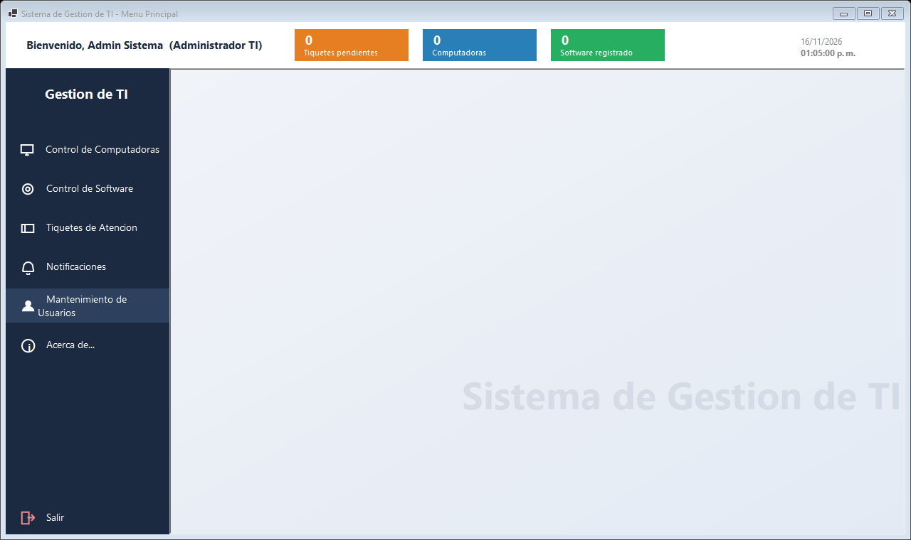
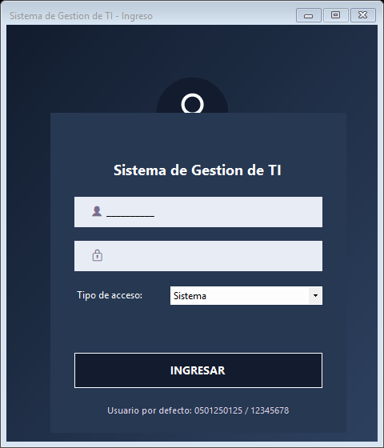
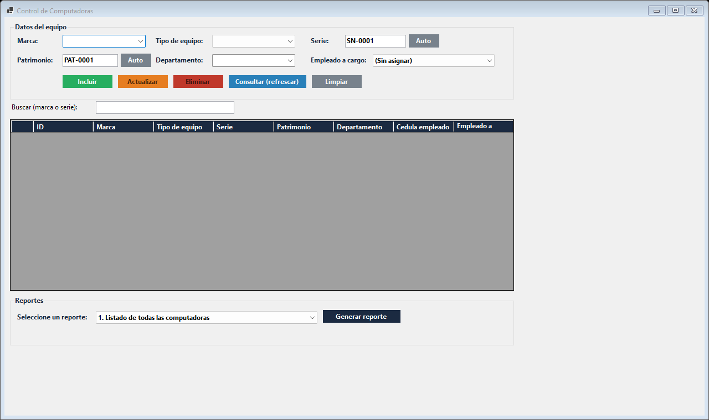
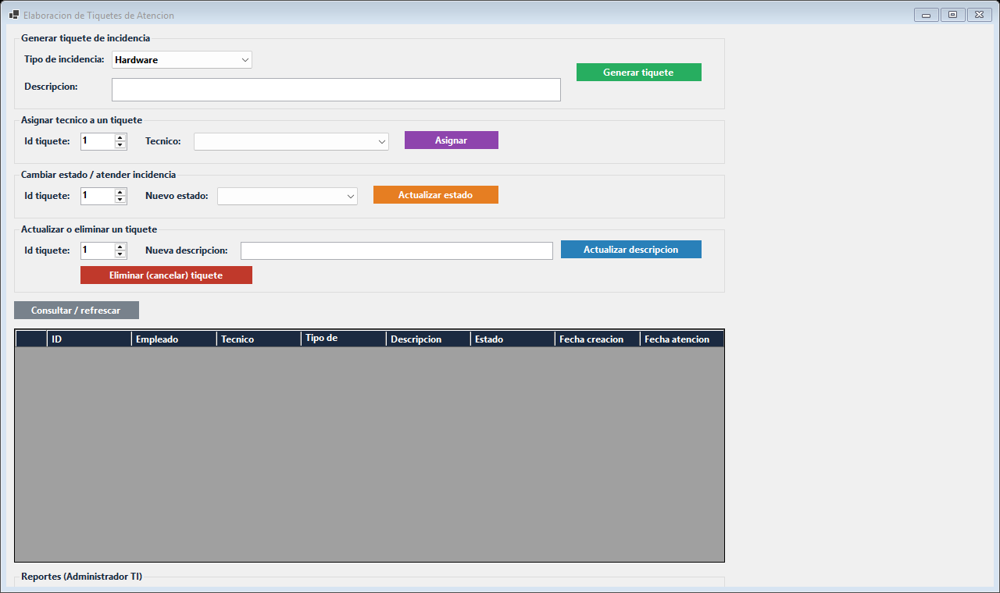
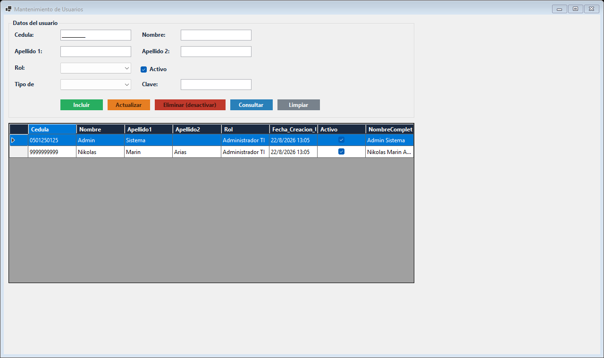

# Sistema de Control de Activos de TI y Tiquetes de Soporte

> **EN:** Desktop application in **C# (.NET 8, Windows Forms)** with **SQL Server** to manage an organization's IT assets: hardware inventory, software licenses and support tickets, with role-based access (Employee, IT Technician, IT Administrator). Final project for Programming IV, Computer Systems Engineering, UACA (Costa Rica), 2026.

Proyecto Final de **Programación IV** (II Cuatrimestre 2026), Bachillerato en Ingeniería en Sistemas Computacionales, Universidad Autónoma de Centroamérica (UACA).

**Autor:** Nikolas Gabriel Marín Arías



---

## ¿Qué problema resuelve?

En un departamento de TI es común perder el control de qué computadoras existen, qué software tiene instalado cada una, cuántas licencias quedan disponibles y en qué estado están las incidencias de los usuarios. Este sistema centraliza esa información y organiza el flujo de soporte técnico entre empleados, técnicos y administradores.

## Funcionalidades

### Autenticación y roles
- Inicio de sesión con dos tipos de autenticación: **Sistema** (clave propia) o **Windows** (valida el usuario de la sesión activa).
- Perfil de usuario y credenciales separados en tablas distintas (`Usuarios` y `Credenciales`).
- Tres roles con permisos diferentes:

| Rol | Puede hacer |
|---|---|
| **Empleado** | Crear tiquetes de soporte y ver su estado |
| **Técnico de TI** | Atender tiquetes asignados, instalar y registrar software, consultar equipos |
| **Administrador de TI** | Gestionar inventario de equipos, usuarios, asignar técnicos y administrar tiquetes |

### Módulos
- **Control de Computadoras:** marca, tipo de equipo, serie, patrimonio, ubicación, departamento y empleado a cargo. Serie y patrimonio se autogeneran con el siguiente consecutivo disponible.
- **Control de Software:** nombre, versión, fecha de instalación, técnico que lo instaló, tipo de licenciamiento y observaciones. Controla el **stock de licencias** y permite asignar un programa a una o varias computadoras.
- **Tiquetes de Atención:** el empleado reporta una incidencia (Hardware, Software, Red, Cuenta de usuario u Otro), el administrador asigna un técnico y el técnico cambia el estado hasta resolverla.
- **Usuarios:** mantenimiento completo de usuarios y roles.
- **Notificaciones:** al iniciar sesión, el administrador ve los tiquetes pendientes y el técnico los que tiene asignados.

Todos los módulos tienen **CRUD completo** (incluir, consultar, actualizar, eliminar) y al menos **5 reportes** cada uno.

### Interfaz
- Menú lateral con íconos, barra superior con usuario, rol y reloj, y tarjetas de indicadores (tiquetes pendientes, computadoras, software).
- Estados con color en tiquetes y en el stock de licencias.
- Validaciones: campos obligatorios, duplicados (serie, cédula), errores de llave foránea explicados al usuario y manejo de excepciones en cada pantalla.

## Capturas de pantalla

| Inicio de sesión | Control de computadoras |
|---|---|
|  |  |
| **Tiquetes de atención** | **Mantenimiento de usuarios** |
|  |  |

## Tecnologías

- **Lenguaje:** C#
- **Plataforma:** .NET 8, Windows Forms
- **Base de datos:** SQL Server (ADO.NET)
- **IDE:** Visual Studio 2022

## Estructura del proyecto

```
ProyectoFinalPIV/
├── Database/      # Scripts SQL: creación de la base de datos y datos de ejemplo
├── Datos/          # Acceso a datos (repositorios por entidad y conexión a SQL Server)
├── Formularios/    # Pantallas: Login, Principal, Computadoras, Software, Tiquetes, Usuarios, Notificaciones, Acerca de
├── Modelos/        # Clases de dominio: Usuario, Credencial, Computadora, SoftwareInstalado, Tiquete
├── Utilidades/     # Estilos de la interfaz e íconos generados por código
├── App.config      # Cadena de conexión
└── Program.cs      # Punto de entrada
```

La aplicación separa responsabilidades en capas: los **formularios** solo manejan la interfaz, los **repositorios** concentran las consultas SQL y los **modelos** representan las entidades del negocio.

## Cómo ejecutarlo

1. Tener instalado **SQL Server** (Express sirve) y **Visual Studio 2022** con la carga de trabajo de escritorio .NET.
2. En SQL Server Management Studio, ejecutar `Database/CrearBaseDatos.sql` (crea la base `ProyectoFinalPIV`, las tablas y el usuario por defecto). Opcional: ejecutar `Database/DatosDemo.sql` para cargar usuarios, equipos, software y tiquetes de ejemplo.
3. Abrir `App.config` y cambiar el nombre del servidor en la cadena de conexión por el de tu instancia.
4. Abrir `ProyectoFinalPIV.csproj` en Visual Studio y presionar **F5**.

Usuario por defecto (rol Administrador de TI): cédula `0501250125`, clave `12345678`.
Con los datos de ejemplo también se puede entrar como Empleado (`101110111`) o Técnico de TI (`303330333`), con la misma clave.

## Modelo de datos

| Tabla | Descripción |
|---|---|
| `Usuarios` | Perfil, rol y estado (activo/inactivo) |
| `Credenciales` | Tipo de autenticación (Sistema/Windows) y datos de acceso |
| `Computadoras` | Inventario de equipos y empleado a cargo |
| `Software` | Programas, licenciamiento, stock de licencias y técnico que instaló |
| `SoftwarePorComputadora` | Relación N:M entre software y computadoras |
| `Tiquetes` | Incidencias, técnico asignado, estado y fechas |
